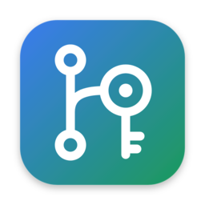
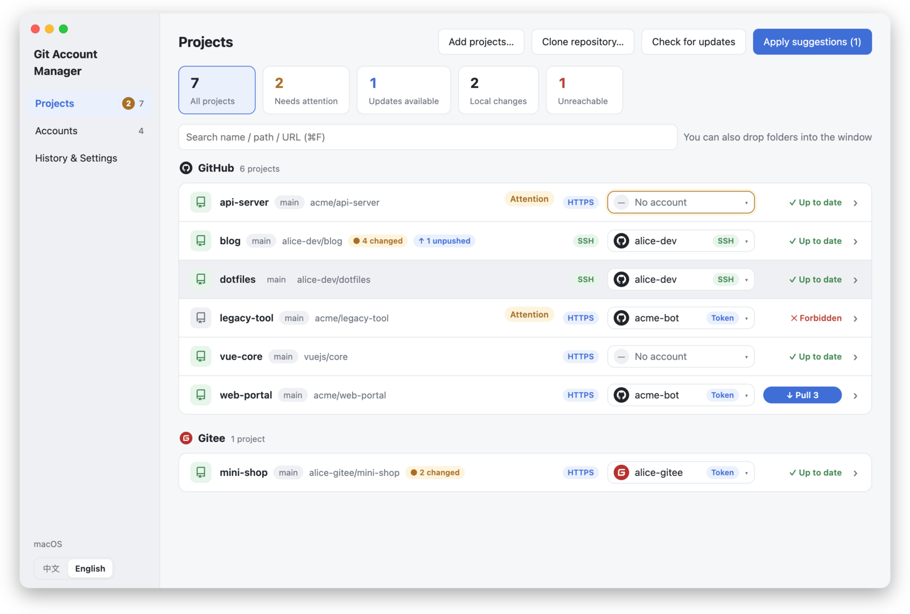
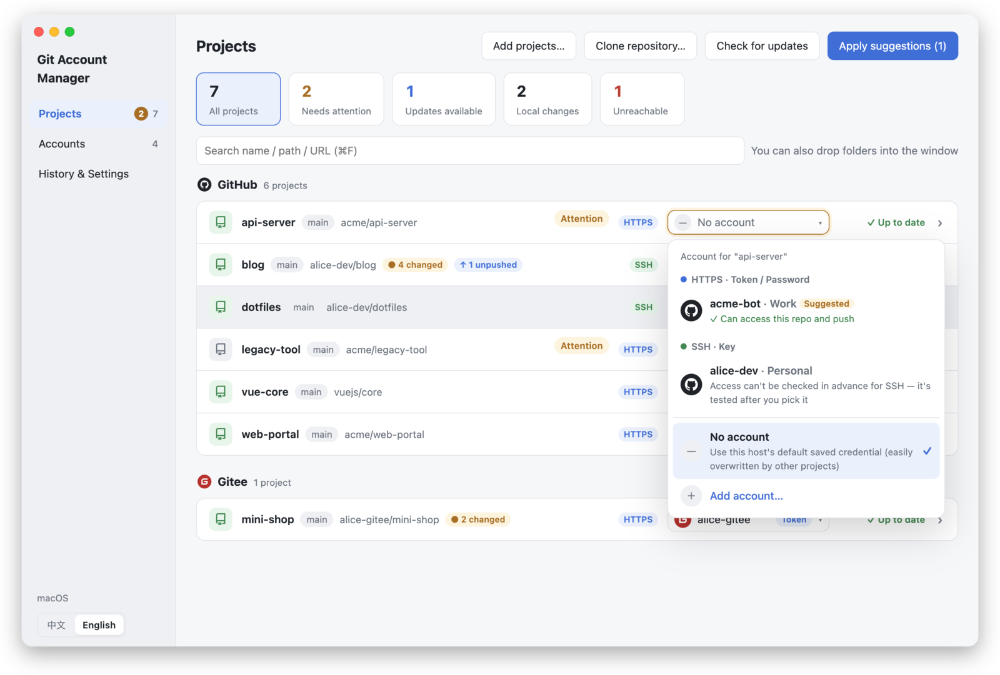
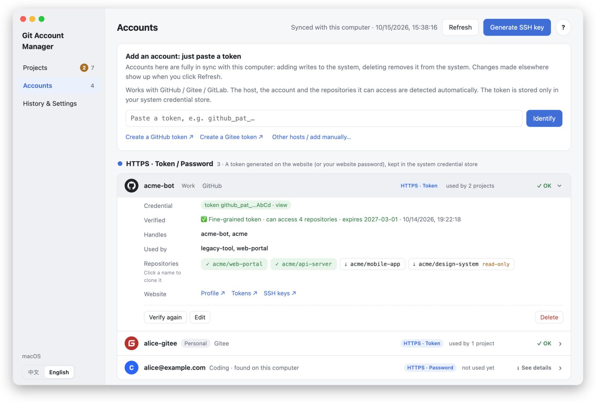
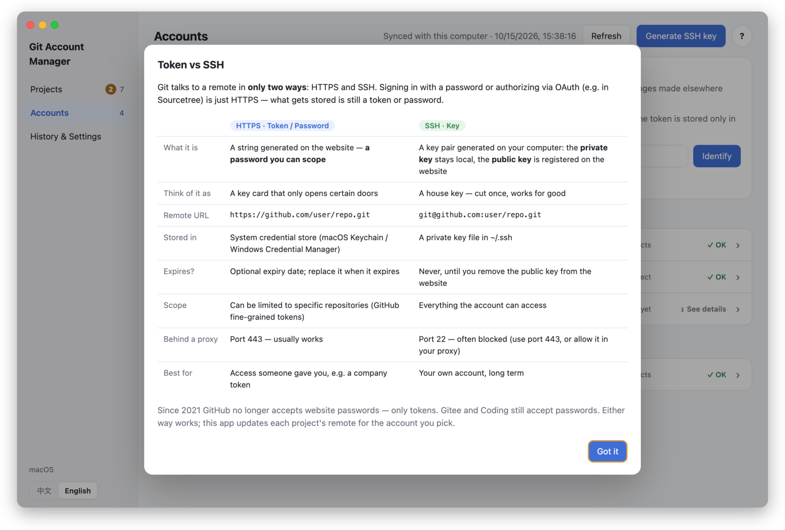
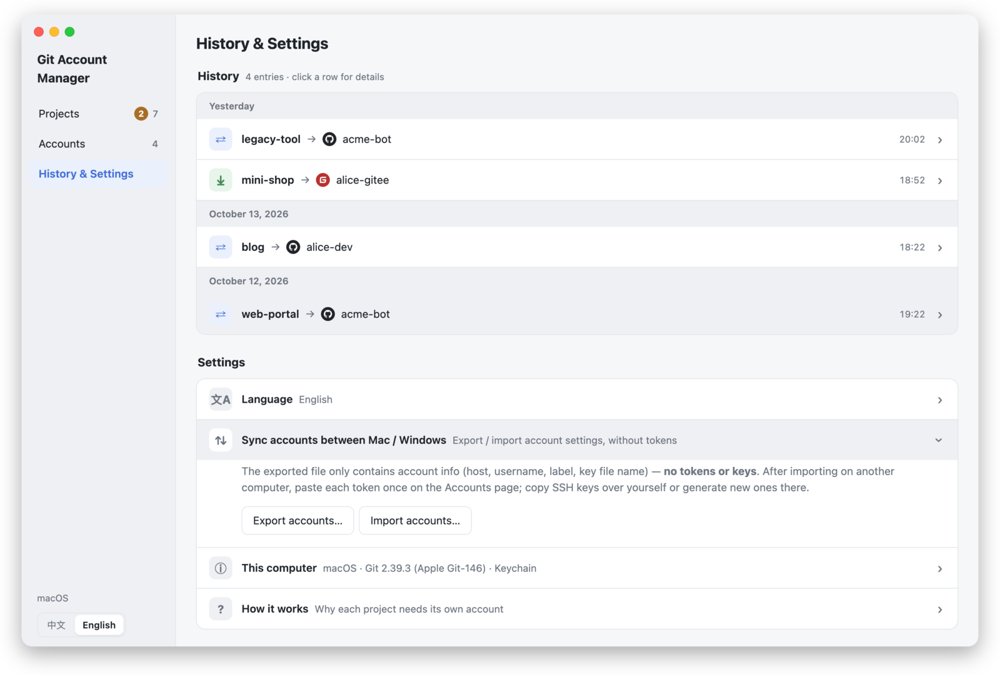

<div align="center">



# Git Account Manager

**One place to decide which Git account every project uses — tokens and SSH keys, on macOS & Windows.**

[](https://github.com/50kg/git-account-manager/releases/latest)
[](https://github.com/50kg/git-account-manager/releases)
[](LICENSE)


English · [简体中文](README.zh-CN.md)



</div>

## ❤️ Sponsors

<details open>
<summary>Click to collapse</summary>

<table>
<tr>
<td width="180" align="center"><a href="https://lingkeai.ai/"><br><b>LingkeAI</b></a></td>
<td>Thanks to LingkeAI for sponsoring this project! LingkeAI is an AI model hub built around <strong>AI agents</strong> that take you from script to finished video: <strong>AI Comic Drama</strong> turns a story into storyboards, characters, dialogue, voice-over and video; <strong>Story to Video</strong> turns long text into a narrated video with subtitles and background music; <strong>Multi-frame</strong> builds a coherent long video from a few reference images; plus <strong>Music MV</strong>, <strong>viral video remake</strong> and <strong>digital human</strong> agents. 500+ leading models for chat, images and video are available under the same account. Sign up through <a href="https://lingkeai.ai/">this link</a> to get a <strong>free starter pack</strong>!</td>
</tr>
</table>

</details>

---

## Why

If you have a company GitHub token, a personal GitHub account, a Gitee account and a couple of SSH keys, you have probably seen this:

> You pull project A, Git asks for a password, you paste the token for account B — and now project C stops working.

That happens because the system credential store (macOS Keychain / Windows Credential Manager) keeps **one password per host + username**. When a remote URL has no username (`https://github.com/org/repo.git`), every project on that host shares a single credential, and whichever one was saved last wins.

**Git Account Manager** gives each project its own account:

- HTTPS projects get the username written into the remote URL (`https://alice@github.com/org/repo.git`), so each account keeps its own credential.
- SSH projects get a dedicated key via `core.sshCommand`, no `~/.ssh/config` juggling.

It only edits each project's `.git/config`. Your code is never touched, and every change can be undone.

## Features

**Projects**
- Drag folders into the window (or a parent folder — repos inside are found automatically).
- Pick an account per project from a picker that tells you whether each account **can access that repository** (push / read-only / not authorized).
- "Apply suggestions" binds every project to the right account in one click.
- See at a glance: uncommitted changes, unpushed commits, new commits on the remote. **One-click pull** (fast-forward only — it refuses and explains when branches diverge or local changes would be overwritten).
- Clickable status counters to filter: needs attention / updates available / local changes / unreachable.
- Open in Finder / Explorer, Terminal, **Sourcetree**, or the repository web page.

**Accounts** — always in sync with your machine
- **Paste a token, that's it.** GitHub / Gitee / GitLab tokens are identified automatically: which host, which user, which repositories it can reach.
- Accounts already in your Keychain and keys already in `~/.ssh` show up automatically. If SSH is blocked by a proxy, keys are still matched through GitHub's public key listing.
- Add here → written to the Keychain / `~/.ssh`. Delete here → removed from the Keychain, SSH keys moved to the Trash.
- **Generate an SSH key** and register the public key on GitHub / Gitee / GitLab through the API — no copy-paste.
- **Clone** any repository an account can access, straight into the project list, already bound to that account.
- View token / password / public key on demand.

**Safe by design**
- Tokens live only in the system credential store. The app's own config never contains secrets.
- Connectivity checks hand credentials to Git read-only, so a failed check can't make Git erase your stored token.
- Full change history with undo. Export/import account settings (without secrets) between machines.

**English & 中文**
- The UI follows your system language; switch between English and Simplified Chinese any time from the sidebar.

## Screenshots

| Pick an account, see access at a glance | Accounts grouped by HTTPS / SSH |
|---|---|
|  |  |

| Token vs SSH, explained in the app | History with undo |
|---|---|
|  |  |

> Screenshots use made-up demo data. The app speaks English and Simplified Chinese — it follows your system language, and you can switch any time in the bottom-left corner.

## Download

Get the latest version from **[Releases](https://github.com/50kg/git-account-manager/releases/latest)**:

| Platform | File |
|---|---|
| macOS (Apple Silicon) | `Git-Account-Manager-<version>-arm64.dmg` |
| macOS (Intel) | `Git-Account-Manager-<version>-x64.dmg` |
| Windows (installer) | `Git-Account-Manager-Setup-<version>.exe` |
| Windows (portable) | `Git-Account-Manager-<version>-portable.exe` |

Requires [Git](https://git-scm.com/downloads) to be installed.

> **macOS:** the app is not notarized yet. If macOS says the app "is damaged" or "can't be opened", run
> `xattr -cr "/Applications/Git账号管家.app"` once, or right-click the app → **Open**.
> **Windows:** SmartScreen may warn about an unknown publisher — click **More info → Run anyway**.

## Quick start

1. **Accounts** → paste a token (e.g. a GitHub fine-grained token). Your existing Keychain accounts and SSH keys are picked up automatically.
2. **Projects** → drag your project folders into the window.
3. Click **Apply suggestions**, or pick an account for each project.
4. Done. Pull / push from the command line, your IDE or Sourcetree as usual — each project now uses its own account.

## Token or SSH?

Git talks to a remote in only two ways:

| | HTTPS + token (or password) | SSH + key |
|---|---|---|
| What it is | A string generated on the website — a password you can scope | A key pair generated on your machine: private key stays local, public key is registered on the website |
| Remote URL | `https://github.com/user/repo.git` | `git@github.com:user/repo.git` |
| Stored in | Keychain / Credential Manager | `~/.ssh` |
| Expires | Optional expiry date | Never, until you remove the public key |
| Scope | Can be limited to specific repos (GitHub fine-grained) | Everything the account can access |
| Behind a proxy | Port 443 — usually works | Port 22 — often blocked (use port 443 or allow it in your proxy) |

Signing in with a password or via OAuth (e.g. in Sourcetree) is just HTTPS — what gets stored is still a token or password.

## Using it with Sourcetree

- **SSH projects** work in Sourcetree right away — it honours the per-project key.
- **HTTPS projects:** Sourcetree's bundled Git uses its own account store, not the Keychain. Switch to **Settings → Git → Use System Git** so Sourcetree shares exactly the same credentials as this app and your terminal.

## Build from source

```bash
git clone https://github.com/50kg/git-account-manager.git
cd git-account-manager
npm install
npm start              # run in development
npm run dist:mac       # build .dmg
npm run dist:win       # build .exe (works on macOS too)
```

<details>
<summary>Faster downloads in mainland China</summary>

```bash
export ELECTRON_MIRROR=https://npmmirror.com/mirrors/electron/
export ELECTRON_BUILDER_BINARIES_MIRROR=https://npmmirror.com/mirrors/electron-builder-binaries/
npm install --registry=https://registry.npmmirror.com
```
</details>

Project layout: `src/core.js` holds all logic (Git, credential store, token detection, SSH), `src/main.js` is the Electron main process, `renderer/` is the UI. No runtime dependencies besides Electron.

## Roadmap

- [x] English UI (i18n) — since v1.4.0
- [ ] Linux build
- [ ] Code signing / notarization
- [ ] Auto update
- [ ] More hosts for one-click key upload (Bitbucket, Azure DevOps)

Ideas and pull requests are welcome — see [CONTRIBUTING.md](CONTRIBUTING.md).

## Security

Credentials never leave your machine except to the Git host you're talking to. See [SECURITY.md](SECURITY.md) for details and how to report a vulnerability.

## License

[MIT](LICENSE) © 50kg. Third-party notices: [THIRD_PARTY_NOTICES.md](THIRD_PARTY_NOTICES.md).
GitHub, Gitee, GitLab and Sourcetree are trademarks of their respective owners; this project is not affiliated with them.
